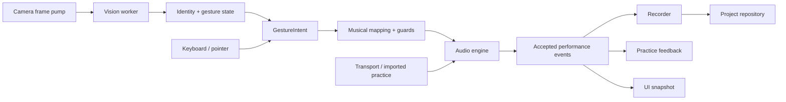

# Vybe: architecture and engineering decisions

Version: 1.0 · 2026-10-12 · Status: target architecture; application code and hardware benchmarks do not yet exist

Read [PRD.md](PRD.md) for required behavior, [DESIGN_SYSTEM.md](DESIGN_SYSTEM.md) for presentation, and [AGENTS.md](AGENTS.md) for the working process. The [phase breakdown](IMPLEMENTATION_PHASES.md) controls delivery order. Decisions below refine that plan and record their trade-offs; they are not claims that browser capabilities or performance have already been tested on the target machine.

## 1. Decisions

| ID | Decision and reason | Alternative and cost accepted |
|---|---|---|
| A01 | One local browser application, static assets served at `http://localhost:4173` | A native wrapper adds installation and packaging work without first resolving tracking quality. Browser audio/output behavior must be measured. |
| A02 | React + TypeScript + Vite; native Web Audio for playback | A full-stack framework adds server concepts without a server-side product requirement. Direct audio ownership requires more explicit voice/envelope code than a generic sampler library. |
| A03 | MediaPipe inference in one worker; gesture interpretation is a small pure main-thread module | Main-thread inference can block the interface; a remote tracker adds privacy and latency costs. Worker/OffscreenCanvas delegate compatibility is an early benchmark task. |
| A04 | Explicit state machines, typed commands, and synchronous audio dispatch | React state/effects are unsuitable as the note scheduler. Keep high-rate musical runtime state outside React. |
| A05 | Native IndexedDB behind one repository adapter; versioned JSON + asset archive | A backend database adds account/network dependencies. Browser storage can be cleared, so archives and transactional recovery are required. |
| A06 | Immutable original takes plus reversible edit descriptions | Destructive quantization is simpler but loses the performed timing. Rendering edited takes must be deterministic. |
| A07 | Fixed chord pitch snapshots; Tonal assists construction and suggestions | Reinterpreting symbols at playback can change saved music after a library update. Some projects store pitches that a symbol alone would not describe. |
| A08 | Locally packaged model/WASM/samples/fonts with checksums and notices | Runtime CDNs simplify setup but defeat offline operation and reproducibility. Installation is larger and assets need a manifest. |
| A09 | Tests plus separate actual-camera/owner gates | Simulated hands make repeatable tests but cannot establish camera accuracy, physical latency, or comfort. |

No auth service, application API server, cloud storage, microservices, external LLM, or model training pipeline is needed. Hand landmark inference is the only learned model in the runtime.

## 2. Project layout and dependencies

```text
Vybe/
  PRD.md
  DESIGN_SYSTEM.md
  architecture.md
  AGENTS.md
  IMPLEMENTATION_PLAN.md
  IMPLEMENTATION_PHASES.md
  gesture-studio/                  # created during application implementation
    package.json
    package-lock.json
    public/assets/                # models, WASM, fonts, licensed audio, manifests
    scripts/                      # local server, asset preparation/verification
    src/
      app/                        # application shell and SessionController
      domain/                     # contracts, theory, gestures, layout, timing, edits
      runtime/
        camera/                   # MediaStream lifecycle and frame pump
        tracking/                 # worker adapter and identity continuity
        audio/                    # voice engine, graph, instrument renderers
        transport/                # clocks, scheduling, recording
      features/                   # play, calibration, practice, studio, settings
      persistence/                # repository, migrations, snapshots
      io/                         # MIDI, audio, archives, WAV
      ui/                         # reusable accessible controls and status components
      styles/                     # tokens.css and component styles
      workers/                    # vision.worker.ts, import/export worker work
    tests/                        # unit/integration/E2E fixtures
    docs/                         # progress, decisions, benchmark and acceptance evidence
```

Use Node 24 LTS and npm as the tooling baseline. Resolve compatible stable package versions during Phase 2 and commit the lockfile; do not paste `@latest` URLs into runtime code. Required runtime libraries are React, `@mediapipe/tasks-vision`, `tonal`, and `@tonejs/midi`. Use `fflate` for ZIP streaming with explicit expansion limits. Use native browser storage and audio APIs through project-owned adapters. Tests use Vitest and Playwright; axe-core may be used for automated accessibility checks, supplemented by keyboard inspection.

Domain modules import neither React nor browser globals. Runtime and IO modules depend on domain contracts. Features depend on domain services and adapters; a feature must not reach into another feature's component state. No audio scheduling from components, hooks, or a UI store.

## 3. Runtime data flow



`SessionController` owns lifecycle, configuration revision, active input source, and routing. It dispatches musical work before publishing an immutable UI snapshot. A failed/blocked intent is logged for practice but never passed off as a sounded event. The recorder stores accepted events from armed live sources; it must not recursively record playback or previews.

Canvas cursors and the playhead render with `requestAnimationFrame` from runtime snapshots. React receives semantic changes and throttled diagnostics, not a new state object for each landmark. Subscriber failures must not prevent note-off or panic handling.

## 4. Time, identifiers, and contracts

### Units

- Main-thread monotonic timestamps: `performance.now()` milliseconds, suffixed `Ms`.
- Audio scheduling: `AudioContext.currentTime` seconds, suffixed `Sec`.
- Musical positions: ticks at an internal PPQ of 960, suffixed `Tick`; allow fractional ticks in original takes to avoid early rounding.
- Imported MIDI keeps original bytes/PPQ; convert its working representation to 960 PPQ without destroying the original.
- Calendar timestamps are ISO UTC strings for project metadata only. Never schedule audio using `Date.now()`.

Pass the main-thread frame timestamp through the worker unchanged. The worker returns its own elapsed inference duration, not an absolute timestamp assumed to share the main thread's origin. `getOutputTimestamp()` may correlate displayed playback with the output clock; it does not measure camera exposure or completed pinch time. [Clock reference](https://developer.mozilla.org/en-US/docs/Web/API/AudioContext/getOutputTimestamp)

### Contract outlines

These are the required meanings; implementation adds discriminated unions, branded IDs, runtime validation, and instrument-specific settings.

```ts
type HandRole = "left" | "right";
type EventSource = "live-left" | "live-right" | "clip" | "practice" | "preview";

interface TrackingFrame {
  epoch: number;
  sequence: number;
  deliveredAtMs: number;          // main thread, before transfer
  returnedAtMs: number;           // filled on receipt
  inferenceDurationMs: number;
  imageSize: { width: number; height: number };
  hands: TrackedHand[];          // IDs, landmarks, handedness, geometry validity
}

interface GestureIntent {
  id: string;
  configurationRevision: number;
  hand: HandRole;
  action: "press" | "release" | "rest" | "lost";
  targetId: string | null;
  requestedAtMs: number;
  velocity: number;              // integer 1..127 for press
}

interface NoteOn {
  kind: "note-on";
  voiceId: string;
  source: EventSource;
  sourceId: string;              // lane or clip/iteration identity
  trackId: string;
  note: number;                  // MIDI; instrument-aware validation
  velocity: number;
  audioTimeSec: number;
  intentId?: string;
}

interface ChordPad {
  id: string;
  label: string;
  notes: number[];               // unique, ascending, 1..8 notes in 21..108
  displaySpellings: string[];
  voicingName: string;
}
```

`PerformanceEvent` is the union of note-on, key release, effective voice release, sustain change, and source flush. Include the reason for forced release: rest, loss, stop, seek, loop boundary, voice limit, or lifecycle failure. `voiceId` pairs the exact attack and release; MIDI pitch is never a voice identifier.

`TrackedHand` uses stable runtime IDs and anatomical roles. MediaPipe handedness score is not a per-landmark tracking confidence. Do not fabricate confidence values absent from its result; retain the configured detector thresholds and separately report frame age/geometry validity. [MediaPipe output and worker behavior](https://developers.google.com/edge/mediapipe/solutions/vision/hand_landmarker/web_js)

All messages and configuration replacements carry an epoch/revision. Increment the relevant epoch on camera restart, audio restart, stopped transport reschedule, and project replacement. Ignore late results from earlier epochs. Changing mappings flushes live owners and requires neutral hands before rearming.

## 5. Camera, tracking, and gestures

### Frame processing

Request video only, ideally 1280 × 720 at 30 fps. Read the negotiated settings instead of assuming they were granted. Use `requestVideoFrameCallback` and submit only a new frame when the worker is idle. Fall back to video-time-checked animation callbacks if unavailable. Resize to a 640 px long edge, preserving aspect ratio, as the initial benchmark configuration.

Transfer an `ImageBitmap` into the vision worker; close it in a `finally` block after processing. Configure video mode and two hands. Start detector, presence, and tracker thresholds at 0.6; tune only against labeled fixtures and measured trials. Attempt worker GPU execution and worker CPU execution in the feasibility benchmark. Choose the successful configuration with the lower stable p95 frame turnaround at the required accuracy. Never quietly move inference onto the UI thread after worker initialization fails.

No pending frame queue. A result more than 100 ms old at receipt is stale: discard it for both note triggers and lease renewal. Main-thread watchdog checks missing results, and audio leases enforce release when main-thread work is delayed. Report camera delivery rate and inference rate separately. [Frame callback reference](https://developer.mozilla.org/en-US/docs/Web/API/HTMLVideoElement/requestVideoFrameCallback)

### Coordinates and calibration

Use unmirrored input frames for inference. Transform once into display coordinates (`displayX = 1 - x` when mirrored). Convert normalized landmarks to pixel-corrected coordinates before distance calculations; otherwise the camera aspect ratio biases pinch distances.

Palm center is the mean of wrist and MCP landmarks 5, 9, 13, 17. Pinch ratio is thumb-tip/index-tip distance divided by index-MCP/pinky-MCP distance. Reject implausible or near-zero denominators. Confirm left/right labels by asking for each hand during calibration; record an adapter correction if the SDK convention differs. Do not infer anatomical role merely from screen position.

For each hand gather an open baseline, at least five open/close cycles, and comfortable reach bounds. Let `closedHigh` be the 90th percentile closed ratio and `openLow` the 10th percentile open ratio. Reject if the gap is nonpositive or smaller than three times the larger within-class median absolute deviation. Initial thresholds are `closedHigh + .25 * gap` for press and `closedHigh + .65 * gap` for release. These are calibration-derived starting rules to validate, not proven performance constants.

Use an exponential cursor filter with a starting time constant of 35 ms and timestamp-based alpha. Do not apply that cursor filter to pinch onset. Require a threshold crossing to persist across two valid frames spanning at least 20 ms. Require neutral-open evidence after startup, rest, identity ambiguity, and loss. Compute expressive pinch velocity from a short timestamped ratio history, calibrated separately; fixed velocity remains the default.

Assign identities by minimum wrist/palm displacement with a handedness mismatch penalty. An ambiguous assignment disarms the affected lanes; crossing hands must never swap a melody into the chord lane. Do not extrapolate missing fingers to generate attacks.

### Geometry and gesture state

One pure `LayoutDefinition` produces both visible rectangles and hit tests. Each hand maps its calibrated rectangle to normalized local coordinates. Leave a gap above the bottom rest strip. Natural notes use seven equal columns; accidental centers are at boundaries 1/7, 2/7, 4/7, 5/7, 6/7 on a separate upper row. Chords use four columns and two rows. Empty spaces remain untargetable.

Retain the current hover target within an expanded boundary of 5% of the smaller target dimension; switch only when the cursor clearly enters another target. The displayed hover is the same target later latched on press. Scale-blocked targets are visible targets with a rejection reason, never substituted pitches.

| Current state | Input | Next state / action |
|---|---|---|
| Disarmed/lost | Valid neutral-open evidence | Open; no sound |
| Open | Confirmed close over playable target | Held; latch target/pitch snapshot and emit one press |
| Open | Confirmed close over gap/blocked target | Held-silent; report attempt; no note |
| Held/held-silent | Cursor moves | Retain latched state; no new press |
| Held | Confirmed open | Emit key release; return open |
| Held-silent | Confirmed open | Return open |
| Any live state | Rest strip/control | Flush that lane including pedal-held voices; disarm |
| Any live state | Missing/ambiguous/stale data | Suppress new presses; expire lane lease; require neutral recovery |

Persist calibration parameters and region definitions, not calibration video or landmark traces. Camera identity, aspect ratio, mirroring, and profile/model version determine compatibility. Window resize changes screen layout, so disarm/rebuild hit geometry; normalized camera calibration can remain valid.

## 6. Audio graph and lifecycle safety

Create one `AudioContext({ latencyHint: "interactive" })` after a user gesture. Use its actual sample rate. No `HTMLAudioElement` per note. Live notes start at `currentTime`; delayed processing is not backdated. Previews have a distinct non-recorded owner and conservative gain.

Each voice has an instrument source, envelope gain, owner/track routing, and unique lifetime. A separate live-lane safety gain sits before that lane's dry and effect sends. Track buses apply level/pan, optional tremolo, and reverb send. Mix tracks through master headroom gain and compression into output metering. Start master gain at -6 dB. This is overload protection, not a claim of a true-peak mastering limiter.

### Audio leases

Each valid, unambiguous hand observation renews its lane's audio-clock lease. Schedule the safety gain to begin a 20 ms fade 180 ms after that observation, reaching zero by 200 ms. Refresh/cancel that scheduled expiry only before the old lease has expired. After expiry, retire old voices and require an open-hand reset before creating new ones. This prevents a blocked main-thread timer from keeping a live chord sounding indefinitely.

Implement lease gain automation independently of musical attack/release envelopes. Ordinary releases honor pedal state; rest/loss/panic bypass it. Recorded/preview sources are not renewed by camera frames. On an isolated loss, pre-existing reverb tail may decay; on Stop all, fade and clear effect returns too. Test actual engine automation with a deliberately stalled main thread.

Use orthogonal states:

- Session: `off`, `starting`, `calibrating`, `ready`, `paused`, `error`.
- Transport: `stopped`, `count-in`, `playing`, `recording`, `paused`.
- Hand: states in the table above.

Hidden document, worker crash, camera termination during a camera session, or unexpected audio suspension finalizes an interrupted take, cancels scheduled playback, flushes audio, clears pedal, and disarms input. Stop camera tracks when hidden or when the user turns the camera off. Returning offers Resume; no auto-resume. Pointer cancellation, keyup, focus loss, and component unmount release conventional-input owners. React development remounts must not create duplicate workers or contexts.

### Instrument implementation

- Piano: three sampled velocity layers from Salamander, selected layers 4, 10, 16; map notes to nearest sample root and interpolate layer gain near boundaries. Preserve sample attack offsets in the asset manifest. The audio review must confirm attack responsiveness.
- Electric piano: deterministic FM voice using native oscillators/gains, with velocity-dependent modulation and optional tremolo.
- Pad: detuned oscillator voices with a slow envelope and conservative polyphony cost.
- Plucked bass: oscillator/filter/envelope voice; describe it as synthesized plucked bass, not a recorded upright instrument.
- Percussion: VCSL subset for kick/bass drum, snare, hi-hat, cymbal, shaker, and clap; verify actual source articulations during asset preparation. A percussion bank replaces pitched targets only through an explicit input-bank selection.

Keep the 512 MiB decoded-buffer budget and 128-voice limit from the PRD. Evict only unreferenced decoded buffers; do not evict a playing sample. At the voice limit retire the oldest released tail first, then the oldest pedal-held released key, then the oldest remaining voice, using a short fade. Emit an effective-release event and diagnostic rather than silently losing bookkeeping. Do not claim a dense-load gate passes if it routinely depends on unexpected stealing.

Live and offline rendering use the same instrument constructors and event-to-graph code. Seed any generated noise from stored event identity for repeatable exports.

## 7. Musical mapping and factory data

Tonal computes note names, intervals, scales, chord construction, and suggested alternatives. MIDI integers and stored pitch arrays are authoritative. Scale Guard rejects an out-of-scale melody intent; Chord Guide does not call the audio engine without a user Preview/Apply action. Record configuration/assistance revisions with takes.

All initial scenes use melody octave 4 and C major as the guide reference. Slots five to eight are empty. These exact initial pitches are fixtures, not formulas reevaluated against the current theory library:

| Scene | Pad label | MIDI pitches | Display pitches |
|---|---|---|---|
| Pop | C | 48, 55, 60, 64 | C3 G3 C4 E4 |
| Pop | G | 43, 55, 59, 62 | G2 G3 B3 D4 |
| Pop | Am | 45, 57, 60, 64 | A2 A3 C4 E4 |
| Pop | F | 41, 53, 57, 60 | F2 F3 A3 C4 |
| Soul | Cmaj9 | 48, 52, 59, 62, 67 | C3 E3 B3 D4 G4 |
| Soul | Am9 | 45, 55, 59, 60, 64 | A2 G3 B3 C4 E4 |
| Soul | Dm9 | 50, 53, 60, 64, 69 | D3 F3 C4 E4 A4 |
| Soul | G13 | 43, 53, 59, 64, 69 | G2 F3 B3 E4 A4 |
| Jazz | Dm7 | 50, 57, 60, 65 | D3 A3 C4 F4 |
| Jazz | G7 | 43, 55, 59, 65 | G2 G3 B3 F4 |
| Jazz | Cmaj7 | 48, 55, 59, 64 | C3 G3 B3 E4 |
| Jazz | A7 | 45, 55, 61, 64 | A2 G3 C-sharp4 E4 |

The G13 and Jazz G7 voicings deliberately omit the fifth. Display the actual pitches rather than implying every theoretical chord member is present. Rootless examples are separately named and never automatically substituted.

Use curated progression/voicing templates for suggestions. Rank candidates deterministically by the selected key/context and common tones; show a short reason and the proposed exact notes. Suggestions are not rules declaring other choices wrong. All settings changes that remap targets apply atomically while stopped with neutral hands.

## 8. Transport, recording, and edits

Use an audio-clock scheduler with a 25 ms wake interval and 100 ms lookahead for recorded events. Timers only fill the queue; they never define the beat. The live path bypasses lookahead. A delayed scheduler skips expired events rather than emitting a burst of missed attacks. Surface repeated deadline misses.

Maintain a transport generation and scheduled-source registry. Pause/stop/seek cancels future sources as well as active ones. Each loop iteration creates distinct voice IDs. Tempo changes happen while stopped. On seek, rebuild the notes and pedal state that are active at the destination; never retain voices from the old position.

Each hand routes to at most one armed instrument track. Two hands may share a track if the instrument/settings are shared; voice ownership still distinguishes the lanes. Editing takes, changing routes, and arming percussion banks happen while stopped. Unsupported routes fail visibly rather than choosing a track silently.

During count-in, targets preview but recording is not active; notes initiated before record start are not carried into the take. Require a fresh pinch after the start boundary. Record accepted live events with `audioTimeSec - recordingStartSec`; retain those original seconds, original tempo, source identity, key release, effective release, and pedal events. Convert to ticks for edits without rounding the original.

One loop-record pass ends at the chosen boundary, releases/disarms its participating live lanes, and switches to playback. Trim the working take's held notes at that boundary; preserve the event history. Retakes replace the active take reference with undo, not the previous data. Linear takes stop at user Stop or the 10-minute limit.

Quantization renders a derived event list. Snap onset to the selected grid and shift key/effective release by the same delta to preserve duration; clamp within the clip with a positive minimum duration. For swing, an offbeat lies at the selected proportion (50–67%) of each two-subdivision pair. Triplets use thirds of a beat. Do not apply swing to an already swung original without an explicit edit setting. Store original events and edit settings separately and use stable ordering for simultaneous events.

Keep UI beat position separate from musical scheduling. A busy rendering frame must not move a beat or alter an exported take.

## 9. Practice and file IO

Parse imports in a worker where practical and validate all file metadata/content before modifying the project. Enforce the PRD size/count/duration limits before expensive allocation, and recheck after decoding. For WAV inspect its header; for compressed input inspect available metadata first, then validate the actual decode. If duration cannot be safely determined, require a shorter/converted input rather than allocating without bounds.

### MIDI

Read type 0/1 PPQ MIDI with `@tonejs/midi`; retain original bytes and controller events even when unsupported for rendering. Convert notes, CC64, tempo, and meter to the internal representation. Create an import report for unsupported controllers, program changes, range, and polyphony. Do not execute or render text/metadata as HTML. [MIDI library reference](https://github.com/Tonejs/Midi)

Highest-note simplification: group simultaneous onsets, retain the highest pitch at each onset, and truncate its duration at the next retained onset. Do not resurrect an older overlapping note when a later note ends. Label the derived track; the original stays untouched. Accompaniment retains its original polyphony.

Practice stores phrase boundaries, transposition, selected tracks, and speed as derived settings. Speed scales all tempo segments together. Wait-for-note pauses the practice timeline and accompaniment at a target, then resumes after the matching accepted intent. Use an initial continuous-mode match window of ±150 ms; nearest unmatched expected pitch wins, with each expectation matched once. Blocked/wrong attempts remain visible. Timing assessment is disabled in wait mode, and assistance context is displayed with results.

### Backing and percussion

Backing sources use original seconds, start offset, and an optional loop window; never stretch them to Studio BPM. Clamp short fades to 5 ms or half the window length, whichever is smaller. Scheduling, seeking, and mute/solo use the common transport. A muted backing track cannot silently resume after a tempo change without an alignment reminder.

Percussion step patterns are explicit event data. Standard output mappings are kick 36, snare 38, closed hat 42, open hat 46, cymbal 49, shaker 70, and clap 39. Close-hat events choke the open-hat group. Pattern playback starts only with user action and exports as ordinary percussion events.

### Export

MIDI export uses type 1, one musical track per Studio track, 960 PPQ, and project tempo/meter. Use percussion channel 10 and distinct melodic channels for the remaining tracks. Bake sustain and forced releases into effective note durations by default, rather than emitting ambiguous pedal events that might keep a lost-hand note sounding. Raw key/pedal events remain in the project archive. Do not emit CC64 as well as baked sustain. Note pitch/velocity/duration round-trips are required; exact timbre in another MIDI player is not promised.

WAV uses `OfflineAudioContext`, stereo 48 kHz, 16-bit PCM, a master fade, and up to three seconds of effect tail. Include the selected take edits, mix, and backing; exclude count-in/metronome. Export requires stopped transport and disarmed live input. Preflight temporary render/encode allocations against the additional 768 MiB export budget, separate from the 512 MiB decoded-asset budget; render serially and release temporary buffers. Report progress from actual render/encode work and provide cancellation. Never install a silent substitute instrument to finish an export.

## 10. Persistence and archives

Use a single IndexedDB database `vybe`, with logical stores for projects, immutable takes, imported assets, calibration profiles, preferences, project revisions, and Trash. Each project has a schema version, revision number, and required asset-pack version. Persist serializable data only: no DOM nodes, audio nodes, workers, or live MediaStreams.

Project snapshots reference track IDs, source take IDs, edit settings, exact voicings, instrument settings, tempo, loop definition, assistance context, and imported asset IDs. Imported asset blobs are stored separately and deduplicated by SHA-256. Built-in assets live in the installation and are referenced by pack/version/checksum.

Autosave non-recording edits after two seconds of idle; commit takes immediately and checkpoint active recording events at least once per second. Last-second data may be lost on abrupt process termination; disclose that limit rather than promising unload saves. “Saved” reflects the committed revision. On transaction failure keep memory state and show an export recovery action. [Persistent storage behavior](https://developer.mozilla.org/en-US/docs/Web/API/StorageManager/persist)

Use a Web Lock per open project to enforce one writing tab, with a read-only second-tab state. Do not rely on BroadcastChannel alone as a lock. Schema migration is atomic; keep the previous serializable snapshot until successful validation. Failure leaves the old data usable or exportable. Never clear a database to make a migration pass.

Archive structure:

```text
project.vybe.zip
  manifest.json     # schema, project identity, required packs, entry sizes/hashes
  project.json      # settings, tracks, takes, edit data, practice context if saved
  assets/<hash>     # original user-imported MIDI/audio
```

Validate ZIP paths, entry counts, declared/actual sizes, expansion limits, checksums, schema, and all references. Reject absolute paths, `..`, duplicate names, and missing media. Extract into memory/temporary import state only; validate the whole archive before one atomic import. New import IDs prevent overwriting an existing project. Do not package calibration/device identifiers by default; they belong to the local machine, not the music project.

Trash is soft deletion. Restore preserves references; permanent deletion is explicit and must not remove shared assets still used by another project/revision. Do not silently garbage-collect source takes while Undo or an archive operation references them.

## 11. Assets, packaging, and security

Bundle the MediaPipe model/WASM, font files, piano subset, and percussion subset locally. A build-time asset manifest records source URL, upstream version/commit, local filename, SHA-256, license notice, sample root/velocity/attack offset, byte size, and decoded-size estimate. Check the license of the exact model/binary as well as its JavaScript package. Preserve licenses and notices for derivatives and font subsets.

Download/preparation scripts are explicit installation tasks, not playback behavior. They verify checksums and stop on mismatch. An instrument's unavailable assets prevent arming that instrument; the app can still manage projects and use already available sounds.

Use `npm run dev` and `npm run start` on the same strict localhost port, never silently choosing another origin. The production start command serves built files; it is not an application backend. Bind to loopback, restrict host headers, and do not expose the server to the LAN. If the port is occupied, show a useful error; do not kill an unrelated process.

No service worker in v1: the local server and local assets provide offline operation and avoid stale model/app combinations. Define a production CSP for self-hosted scripts/assets, only the WASM capability actually required, and narrowly scoped worker/blob use. Do not add blanket unsafe-eval or remote connect allowances to hide a compatibility failure. Disable microphone access through Permissions Policy. Validate runtime imports/settings; TypeScript types are not a parser.

A future desktop wrapper, cloud service, or external device integration requires a new architectural decision and user scope, not a convenient workaround in an unrelated task.

## 12. Verification and observability

Diagnostics are local, bounded, and off the normal playing surface. Track frame delivery rate, inference duration, frame age, worker delegate, accepted/blocked intent counts, audio scheduling lateness, active voice count, asset memory estimate, storage revision, and explicit failures. Do not sum unrelated timing components and call the result measured physical latency. Keep an in-memory rolling window; export summaries only on request.

| Layer | Required checks |
|---|---|
| Domain | Hand states, aspect-corrected pinch ratios, hysteresis, mirroring, identity ambiguity, guard behavior, chord fixtures, theory spelling, timing maps, reversible edits |
| Runtime integration | Worker init/stale epochs, one frame in flight, bitmap disposal, voice ownership, sustain override, lease expiry under stalls, stop/seek cancellation, context restart |
| Audio | Offline envelope/output tests, repeated identical pitches, sample failures, fixed and expressive velocity, loop wrap, graph cleanup, export duration/levels |
| IO/storage | Import limits, malformed MIDI/WAV/ZIP, unsupported versions, transaction/quota failure, migration rollback, duplicate archives, saved-project round-trips |
| Browser | Simulated-camera flow, conventional controls, keyboard focus, resizing, permission denial, hidden-page behavior, offline requests, project restore, accessibility |
| Actual hardware | The PRD's 500-trigger trials, accidental-note test, physical-latency measurement, 20-minute comfort review, and 30-minute loaded session |

Phase 2 creates scripts `typecheck`, `lint`, `test`, `test:e2e`, `build`, and `verify:assets`. Browser E2E uses Chromium for reproducibility; actual Chrome acceptance on the user's laptop is separately recorded. A mocked clock or simulator cannot pass a hardware gate.

Write dated phase evidence under `gesture-studio/docs/`: command/build results, fixtures, benchmark conditions, screenshots, manual outcomes, and outstanding items. Phase 1 remains partially unverified until hardware/browser baselines are checked. Documents alone do not complete a software or hardware phase.
